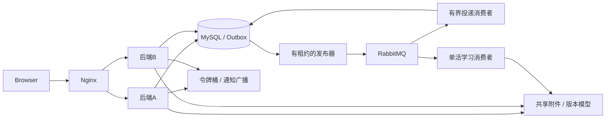

# 本地高并发环境运行与复现

此环境验证站内邮件、单机多实例，不代表生产高可用。外部大模型默认关闭。当前结果见 HIGH_CONCURRENCY_REPORT.md。仓库随附精简验收证据，复测产生的原始数据保存在本地 evidence/。

## 启动

在项目根目录配置已有 `.env` 中的 DB_PASSWORD、MYSQL_ROOT_PASSWORD、JWT_SECRET。不要把 `.env` 加入版本控制。

```powershell
./scripts/start-high-concurrency.ps1
```

访问 http://localhost:5180。使用独立项目 email-hc、独立 MySQL/RabbitMQ/附件卷，保留原环境。需要 Java 17+、Docker Compose v2.24.4+、Python 3；Maven Wrapper 自动取得构建依赖。初次需能下载镜像。

已有数据库升级前先备份。按 V002、V003、V004、V005、V006、V007 顺序执行 database/migrations/ 下的 SQL；V002/V004/V006/V007 只执行一次。V006 会回填收件记录的原始发件时间并创建索引，在停止写入后执行，完成后再启动新版本。V007 回填垃圾邮件记录的发件人并创建发件人和检测时间的联合索引。初始化挂载仅在空数据卷生效。禁止通过删除已有数据卷来解决迁移问题。普通 compose.yaml 的新数据库也会初始化这些表，默认同步模式用于兼容；高并发入口通过上述独立配置启用。

## 正确性及故障验证

```powershell
python scripts/hc_verify.py
./scripts/start-high-concurrency.ps1 -TestMode
python scripts/hc_cross_instance.py
python scripts/hc_faults.py
python scripts/hc_admin.py audit
```

TestMode 仅用于本地实验：开放 127.0.0.1:18081/18082，启用进程退出/失败注入，将租约缩短到10秒，并关闭 A 的队列消费者以证明通知从 B 广播至 A。普通配置故障注入关闭，租约60秒。测试脚本只操作 email-hc 项目；不要指向真实业务环境。

恢复普通双实例配置：

```powershell
docker compose -f compose.high-concurrency.yaml up -d --build
docker compose -f compose.high-concurrency.yaml restart frontend
python scripts/hc_ready.py
```

死信管理只提供本地脚本，无普通用户管理 API：

```powershell
python scripts/hc_admin.py failed
python scripts/hc_admin.py replay --mail 123
python scripts/hc_admin.py audit
```

重放仅从 FAILED 转回 PENDING，沿用原邮件与收件人快照；已成功邮件不会再次创建收件箱记录。死信队列保留历史事件用于排查。

## 数据和压测

```powershell
python scripts/hc_seed.py --count 100000
python scripts/hc_query_benchmark.py --label before-index
python scripts/hc_seed.py --count 1000000
python scripts/hc_query_benchmark.py --label million
```

基准数据使用种子42、保留 ID 区间、固定时间及正文；十万封阶段包含一个十万邮件账号，百万阶段保持该账号十万封。工具可从十万扩展至百万，不清空现有数据。基准账号 bench0..bench100@example.test，测试密码 LocalBench42!；可通过 HC_BENCH_PASSWORD 指定其他值。仅在隔离本地环境使用这些账号。

吞吐与限流实验必须分开。吞吐测试先在当前 PowerShell 设置：

```powershell
$env:RATE_CAPACITY='1000000'
$env:RATE_PER_MINUTE='1000000'
docker compose -f compose.high-concurrency.yaml up -d
docker compose -f compose.high-concurrency.yaml restart frontend
python scripts/hc_ready.py
python scripts/hc_run_load.py --label double --mode mixed --rate 100 --duration 10m --repeats 3
```

`--mode` 支持 list/detail/submit/status/search/attachment/mixed；各接口独立测试，建议20、50、100请求/秒逐档递增，至少预热3分钟并确认CPU/队列趋于稳定，再正式每组10分钟、重复3次。混合负载严格按全局迭代编号分配80%列表/详情、10%标记已读、10%发信，每封5个收件人；投递状态轮询另计 HTTP 请求。k6记录提交与端到端延迟、预期429、非预期错误及失败/观察超时计数（最终结果以数据库核对为准）。

同一标签已有结果时工具拒绝覆盖，请为新实验选择新的 --label。每次保留 raw.json.gz、summary.json、console.log、resources.jsonl、受理清单与最终状态核对。测试后先排空任务再比较；退出码99表示阈值未通过，报告中必须保留失败结果。资源采样包含容器CPU/内存、MySQL连接和队列深度。压测是请求的到达速率，成功吞吐必须从结果计算，不能直接把目标速率当成实测值。

单实例对照使用相同总预算：单实例20个连接、4个消费者、2CPU/1536MB；双实例每个10连接、2消费者、1CPU/768MB。

```powershell
docker compose -f compose.high-concurrency.yaml stop backend-b
docker compose -f compose.high-concurrency.yaml -f compose.hc-single.yaml up -d
docker compose -f compose.high-concurrency.yaml restart frontend
python scripts/hc_run_load.py --label single --mode mixed --rate 100 --duration 10m --repeats 3
```

## 机制与边界

请求在同一事务保存邮件、去重收件人快照、附件绑定、用户隔离幂等键和 Outbox。多实例发布器竞争有时限的租约，固定批次内先发送再逐一等待确认，发布确认与不可路由检查通过后标记；消费者锁定任务、提交业务后手动确认。失败交接也经持久化 Outbox：1/5/30秒三次重试，随后FAILED与死信。进程退出后由扫描器恢复PROCESSING任务。

Redis Lua使用Redis时间进行用户令牌桶计算；Redis故障时新发信503，读取继续。SSE为提示，重连主动刷新列表；数据库为最终事实来源。附件先暂存，提交时校验用户/有效期并绑定，定期清理过期未绑定记录。两个实例共享附件和模型卷；学习队列使用RabbitMQ单活消费者，模型任务/版本持久化，快照临时写入后原子替换，各实例定期加载同一已提交版本。



搜索先以 UNION 限定当前用户可见邮件，再执行 MySQL 模糊匹配；每实例最多两个并发搜索，查询超时5秒，拥塞返回429、超时返回503。仍需独立评估十万邮件热账号的扫描成本。智能整理显式按批次计算并保存分数，后续按分数+邮件ID分页读取；重新整理会重算，百万数据下该操作的成本需要单独记录。模型加载存在刷新间隔，通知可能重复或遗漏，界面应以查询结果为准。


## 结果整理与连续性

负载结束后运行 `python scripts/hc_endpoint_summary.py`（默认匹配 `*release*`，可用 `--pattern` 选择组），再运行 `python scripts/hc_resource_summary.py` 和 `python scripts/hc_report.py`。这些脚本读取保留的原始数据；报告脚本还会从测试数据库核对受理到送达耗时，因此应在清理测试环境之前执行。不要与正式压测并行解析大量原始数据。

主机暂停造成时间断档的轮次保留并标明，不纳入连续 10 分钟正式组。补跑使用新标签，保留已有结果。


### 同构建对照

先完成 V006、V007，并用启动脚本构建一次。试跑使用 `./scripts/hc_run_comparison.ps1 -Label my-pilot -Pilot`。正式对照使用 `./scripts/hc_run_comparison.ps1 -Label my-comparison`，包含单实例和双实例混合负载各三轮，搜索和附件各三轮，以及停机积压恢复。每次使用新标签。脚本记录运行实例、构建哈希和资源配额，结束时恢复默认双实例限流。

运行 `python scripts/hc_endpoint_summary.py --pattern 'my-comparison-*'` 检查时间连续性与接口分项，运行 `python scripts/hc_comparison_summary.py my-comparison` 生成正式轮次汇总。比较时同时看丢弃迭代、投递对账和积压采样。搜索仍保留 MySQL 子串匹配语义。关键词匹配稀少时可能扫描更多可见记录，由现有并发限制和超时控制资源。
